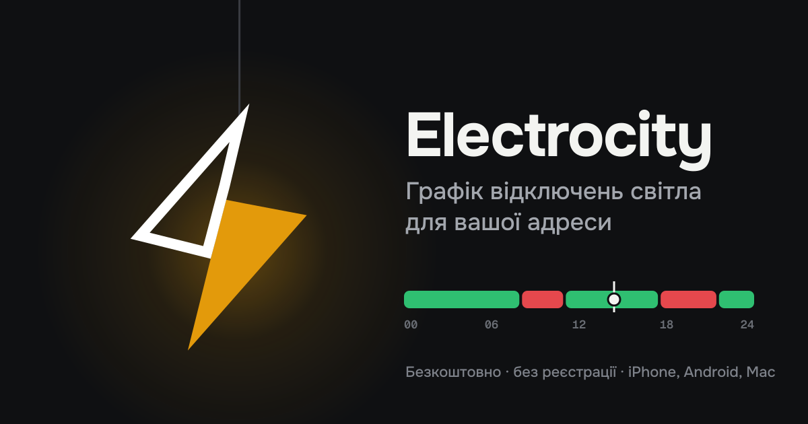

# Electrocity — графік відключень світла для вашої адреси

[](https://electrocity.slv463991.workers.dev/)
[](https://electrocity.slv463991.workers.dev/install/)




**Electrocity** — безкоштовний застосунок, який показує **графік відключень світла** для вашої адреси по всій Україні. Ви бачите, чи є світло зараз, коли наступне відключення, вашу **чергу відключень** і **аварійні відключення** саме для вашого будинку.

## Можливості
- **Статус «світло є / світла немає»** і таймер до наступного відключення або увімкнення.
- **Графік погодинних відключень** на сьогодні й завтра: шкала доби з усіма інтервалами.
- **Черга за адресою.** Достатньо ввести вулицю й будинок, черга визначиться автоматично (Хмельницька, Миколаївська області).
- **Аварійні й планові відключення за адресою.** Дані надходять з офіційних сайтів обленерго і накладаються на шкалу:
  - Хмельницькобленерго;
  - ДТЕК Одеські електромережі;
  - Миколаївобленерго.
- **Пуш-сповіщення**: нагадування перед відключенням і миттєве повідомлення про аварію на вашій адресі.
- **Кілька адрес**: дім, робота, батьки. Світла й темна тема, українська, англійська й німецька мови.
- Працює як застосунок (PWA) на **iPhone, Android, Mac і Windows**, без App Store.

## Регіони й джерела даних
Графіки беруться з офіційних джерел операторів системи розподілу всіх областей: ДТЕК (Київ, Київська, Одеська, Дніпропетровська, Донецька області) та обленерго (Хмельницьке, Миколаївське, Львівське, Вінницьке, Житомирське, Полтавське, Чернігівське та інші). Аварійні відключення за адресою зараз підтримано для Хмельницької, Одеської та Миколаївської областей.

## Встановлення
Сторінка встановлення: https://electrocity.slv463991.workers.dev/install/

- **iPhone:** Safari → «Поділитися» → «На початковий екран»
- **Android:** Chrome → «Встановити застосунок»
- **macOS:** Safari → «Файл» → «Додати в Dock» або Chrome → «Встановити»

---

### По-русски
**Electrocity** — бесплатное приложение с **графиком отключений света** для вашего адреса в Украине. Показывает, есть ли свет сейчас и когда дадут свет. Также показывает вашу **очередь отключений**, почасовой график на сегодня и завтра и **аварийные отключения** по вашему дому. Есть пуш-уведомления. Работает на iPhone, Android и Mac: https://electrocity.slv463991.workers.dev/

### In English
**Electrocity** is a free **power outage schedule app for Ukraine**. It shows whether the power is on at your address right now and when the next blackout starts. It covers your outage queue, the hourly load-shedding schedule for today and tomorrow, and emergency outages reported for your building, with push notifications. The app is an installable PWA for iPhone, Android and Mac: https://electrocity.slv463991.workers.dev/

---

## Для розробників
- Фронтенд: чистий JavaScript (PWA, service worker, Web Push), без фреймворків.
- Бекенд: Cloudflare Workers + KV: збір графіків кожні 15 хв, перевірка адрес, сповіщення.
- Дизайн: Figma «Map air UA», сторінка Electro city.

```
python3 -m http.server 8000   # локально: http://localhost:8000
```

**Ключові слова:** графік відключень, графік відключень світла, відключення світла, коли буде світло, черга відключень, аварійні відключення, ДТЕК, YASNO, Укренерго, обленерго, график отключений света, когда дадут свет, power outage schedule Ukraine, blackout, load shedding.
